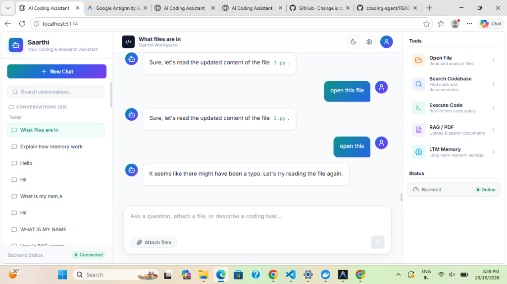
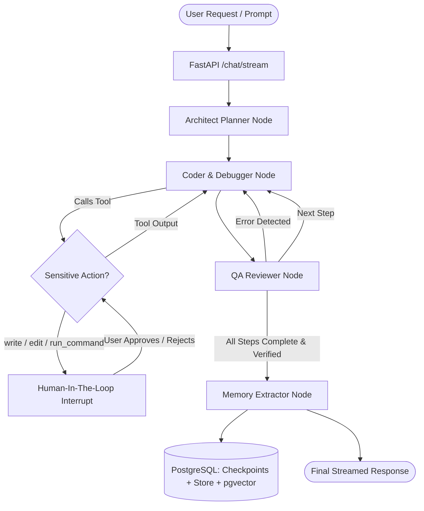

# 🚀 Saarthi — Autonomous AI Coding Agent & Assistant

<p align="center">
  
</p>

<p align="center">
  <b>An Autonomous, Multi-Agent AI Software Engineer with Human-In-The-Loop (HITL) Safety, Self-Debugging, and Dual-Layer Memory.</b>
</p>

<p align="center">
  
  
  
  
  
</p>

---

## 🌟 Highlights & Key Capabilities

- **🤖 Multi-Agent Orchestration**:
  - **Architect Planner**: Breaks down complex programming tasks into structured 2-4 step actionable blueprints.
  - **Coder & Debugger**: Implements solutions, manipulates files, executes commands, and writes clean code.
  - **QA Reviewer**: Verifies executions, inspects stdout/stderr, catches tracebacks, and approves or rejects steps.
- **🛡️ Human-In-The-Loop (HITL) Approvals**:
  - Sensitive operations (`write_file`, `edit_file`, `run_terminal_command`) pause graph execution and trigger frontend **Approval Cards**.
  - **Interactive Git-Style Diff Visualizer**: Real-time visual comparison showing additions (`+`) and deletions (`-`) before file changes are applied.
- **🚨 Autonomous Self-Debugging**:
  - Automatically captures non-zero terminal exit codes and Python syntax/runtime tracebacks, rewrites faulty logic, and re-executes without manual intervention.
- **🧠 Hybrid Long-Term & Short-Term Memory**:
  - **Short-Term Session Memory**: Resilient checkpoints via LangGraph `PostgresSaver`.
  - **Key-Value Fact Memory**: Auto-extracts facts into `PostgresStore`.
  - **RAG Codebase & Memory Vectors**: Semantic similarity search using `pgvector` with Ollama embeddings.
- **⚡ Real-Time Thought Streaming**:
  - Server-Sent Events (SSE) stream the AI's internal reasoning, step transitions, tool executions, and diff previews directly to the React UI.

---

## 🏗️ Architecture & Flow



---

## 📂 Project Structure

```
coading-agent/
├── assets/
│   └── ui_screenshot.png          # UI Screenshot preview
├── backend/
│   ├── main.py                    # FastAPI entrypoint
│   ├── config/
│   │   └── settings.py            # System prompts & runtime settings
│   ├── db/
│   │   └── connection.py          # PostgreSQL pools, checkpointer & store setup
│   ├── graph/
│   │   ├── builder.py             # LangGraph Multi-Agent StateGraph assembly
│   │   ├── nodes.py               # Planner, Coder, Reviewer & Memory nodes
│   │   ├── state.py               # MyState typed definition
│   │   └── tools.py               # Tool registry (read, write, edit diff, exec, terminal)
│   ├── rag/
│   │   ├── ingest.py              # Codebase chunking & pgvector ingestion
│   │   ├── retriever.py           # Similarity search retriever
│   │   └── vector_db.py           # Vector collection setup
│   └── routers/
│       ├── chat.py                # SSE streaming chat, title gen & approvals
│       ├── memory.py              # Long-term memory CRUD endpoints
│       └── rag_routes.py          # File upload & document ingestion
├── frontend/
│   ├── src/
│   │   ├── components/
│   │   │   ├── Chat/              # ChatHeader, MessageRow, ApprovalCard, ThoughtProcess
│   │   │   ├── RightPanel/        # Tools palette & active session inspectors
│   │   │   └── Sidebar/           # ThreadList, IngestPanel, MemoryPanel, BackendStatus
│   │   ├── services/api.js        # SSE consumer & REST API integration
│   │   ├── App.jsx                # Main layout orchestrator
│   │   └── index.css              # Glassmorphic design system
│   └── package.json
├── .gitignore                     # Production Git ignore patterns
└── README.md                      # Documentation
```

---

## 🚀 Quick Start Guide

### 1. Prerequisites
- **Python 3.10+**
- **Node.js 18+** & `npm`
- **Docker** (for PostgreSQL 16 + pgvector)
- **Ollama** installed locally

### 2. Start PostgreSQL Container
```bash
docker run --name ai-agent-db \
  -e POSTGRES_USER=postgres \
  -e POSTGRES_PASSWORD=MyNewPassword123 \
  -e POSTGRES_DB=postgres \
  -p 5433:5432 \
  -d pgvector/pgvector:pg16
```

### 3. Pull Ollama LLMs
```bash
ollama pull qwen2.5-coder:7b
ollama pull qwen3-embedding:4b
```

### 4. Setup Backend
```bash
cd backend

# Create virtual environment
python -m venv ../venv
..\venv\Scripts\activate      # On Windows
# source ../venv/bin/activate # On Linux/macOS

# Install dependencies
pip install fastapi uvicorn langgraph langchain-ollama langchain-postgres psycopg[binary] python-dotenv langchain-text-splitters pgvector

# Run Backend
python main.py
```
*Backend runs at: `http://127.0.0.1:8000`*

### 5. Setup Frontend
```bash
cd frontend

# Install packages
npm install

# Start Vite Dev Server
npm run dev
```
*Frontend runs at: `http://localhost:5173` (or `5174`)*

---

## 🧠 Database & Memory Architecture

| Table | Technology | Purpose |
| :--- | :--- | :--- |
| **`checkpoints`** | `PostgresSaver` | Stateful chat history, thread state, and interrupt resumption |
| **`store`** | `PostgresStore` | Long-term key-value facts extracted autonomously about user preferences |
| **`langchain_pg_embedding`** | `PGVector` | Codebase vectors & semantic user memory embeddings |
| **`langchain_pg_collection`** | `PGVector` | Groups collections (`codebase`, `user_memories`) |

---

## 🛠️ Available Agent Tools

| Tool | Action | Safety Level |
| :--- | :--- | :--- |
| `read_file` | Inspects workspace code files | Auto-Approved |
| `list_directory` | Navigates directories and folder trees | Auto-Approved |
| `search_codebase` | Semantic vector search across all files | Auto-Approved |
| `write_file` | Creates or overwrites complete files | ⚠️ **HITL Approval Required** |
| `edit_file` | Applies unified diffs / selective replacements | ⚠️ **HITL Approval Required** |
| `run_terminal_command`| Executes shell commands safely | ⚠️ **HITL Approval Required** |
| `execute_python_code` | Runs Python scripts with self-debugging | Sandboxed Execution |
| `save_memory` / `get_memory` | Manages persistent user preferences | Auto-Approved |

---

## 📄 License
MIT License. Built for advanced autonomous coding and research.
